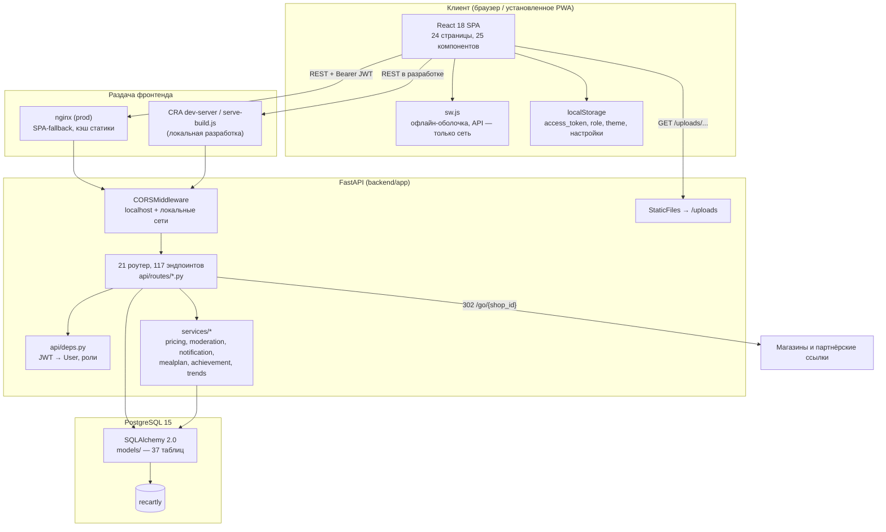
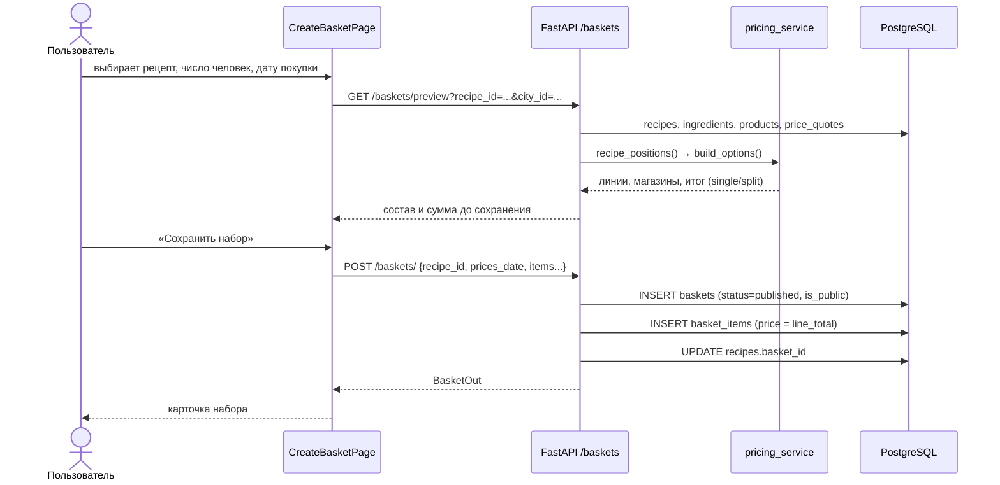
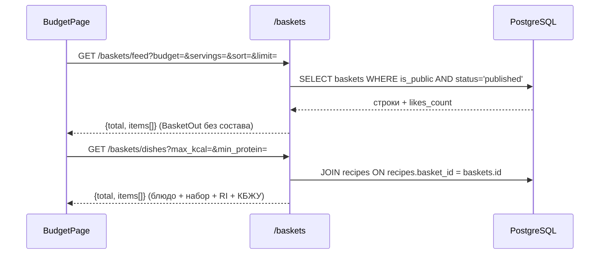
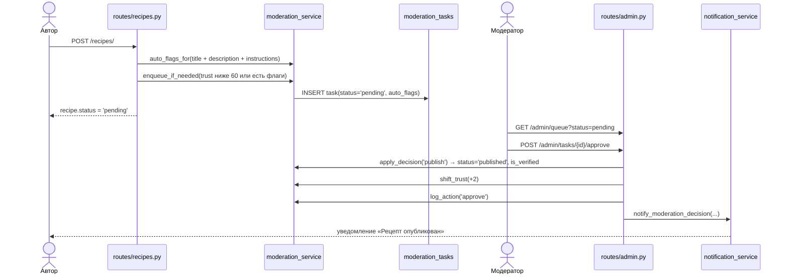

# Архитектура Recartly

Документ описывает, из каких частей состоит приложение, как они связаны и почему приняты
ключевые решения. Рассчитан на нового разработчика: после чтения должно быть понятно, где
живёт та или иная логика и что произойдёт при типовом действии пользователя.

## Оглавление

1. [Общая схема](#общая-схема)
2. [Компоненты и зоны ответственности](#компоненты-и-зоны-ответственности)
3. [Связь фронтенда и бэкенда](#связь-фронтенда-и-бэкенда)
4. [Ключевые сущности](#ключевые-сущности)
5. [Основные потоки данных](#основные-потоки-данных)
6. [Принятые решения и их причины](#принятые-решения-и-их-причины)
7. [Ограничения текущей архитектуры](#ограничения-текущей-архитектуры)

## Общая схема

Приложение — классическая трёхуровневая SPA: React-клиент общается с REST API по HTTP,
API работает с PostgreSQL через SQLAlchemy. Отдельного слоя кэширования или очередей в коде нет:
Redis поднят в Docker Compose, но приложением не используется.

### Что где находится

| Слой | Каталог | Ответственность |
|---|---|---|
| Точка входа API | `backend/app/main.py` | создание `FastAPI`, CORS, подключение роутеров, `/uploads`, `/health` |
| Роуты | `backend/app/api/routes/` | HTTP-контракт: параметры, коды ответов, сериализация |
| Авторизация | `backend/app/api/deps.py`, `core/security.py` | разбор JWT, загрузка `User`, проверка ролей, хеширование паролей |
| Модели | `backend/app/models/` | схема БД и связи, единственный источник правды о таблицах |
| Схемы | `backend/app/schemas/` | Pydantic-валидация входа и форма ответа |
| Бизнес-логика | `backend/app/services/` | расчёты, модерация, уведомления, планы, ачивки |
| Клиент | `frontend/src/` | экраны, компоненты, вызовы API, дизайн-система |
| Статика | `/uploads` → `uploads/` в рабочем каталоге процесса | фото рецептов, шагов, чеков, аватары |

## Компоненты и зоны ответственности

### Бэкенд

- **`main.py`** подключает 21 роутер (20 файлов в `api/routes`, `challenges.py` отдаёт два
  роутера — `challenges_router` и `achievements_router`). Версионирования API нет, все пути
  начинаются с префикса роутера (`/auth`, `/baskets`, …), у `reactions_router` префикса нет —
  его пути выглядят как `/recipes/{recipe_id}/reactions`.
- **`deps.py`** — три уровня доступа: `get_current_user` (необязательная авторизация, вернёт
  `None`), `get_current_user_required` (401), `get_current_moderator` (403 вне ролей
  `moderator`/`admin`), `get_current_admin` (только `admin`). Роль читается из БД, а не из токена.
- **`core/database.py`** — `engine`, `SessionLocal`, `Base`, зависимость `get_db`. Строка
  подключения берётся из `DATABASE_URL`; `load_dotenv()` вызывается опционально (если установлен
  `python-dotenv`), а в Docker переменные приходят из `environment` в compose.
- **`core/security.py`** — JWT HS256, срок жизни 30 минут, bcrypt для паролей.
- **`core/config.py`** — пустой файл. Отдельного конфигурационного модуля нет: значения читаются
  через `os.getenv` в `database.py` и `security.py`.
- **`services/`** — расчётная и модерационная логика; роуты стараются не дублировать формулы.
- **`scripts/`** — операционные задачи: миграция, сиды, диагностика, очистка тестовых данных.

### Фронтенд

- **`App.js`** — маршрутизация и проверка авторизации по наличию `access_token` в
  `localStorage`. Авторизация не хранится в React-контексте: компоненты сами читают
  `localStorage` и слушают события `storage`/`authChange`.
- **`services/api.js`** — низкоуровневый `request()` и функции «старого» домена: авторизация,
  рецепты, избранное, комментарии, профиль, админка, реакции.
- **`services/smeta.js`** — сгруппированные функции «Сметы»: наборы, блюда, гео, каталог,
  цены, акции, меню, остатки, челленджи, уведомления, жалобы, «Моя неделя».
- **`pages/`** — экраны; **`components/`** — переиспользуемые блоки; **`utils/`** — адрес API,
  форматирование, прокрутка лент, «умный возврат».
- **`index.css` + `tailwind.config.js`** — дизайн-система «Смета»: токены, компонентные классы,
  тёмная тема.

## Связь фронтенда и бэкенда

1. **Адрес API.** В `frontend/src/utils/media.js` вычисляется `API_URL`:
   - если `REACT_APP_API_URL` пуст или содержит `localhost`/`127.0.0.1`, адрес собирается из
     хоста страницы и порта `8000`: `http://<host страницы>:8000`;
   - иначе используется `REACT_APP_API_URL` как есть.

   Это сделано для проверки с телефона: `localhost` в браузере телефона указывал бы на сам
   телефон, и запросы падали бы с `Failed to fetch`.

2. **Абсолютные ссылки на файлы.** `mediaUrl(path)` превращает `/uploads/xxx.jpg` в
   `${API_URL}/uploads/xxx.jpg`; `emoji:`-значения, `http(s)://`, `data:` и `blob:` возвращаются
   без изменений.

3. **Авторизация.** `POST /auth/login` возвращает `access_token`; клиент кладёт его в
   `localStorage` и передаёт заголовком `Authorization: Bearer <token>` там, где нужен
   пользователь. Токен не обновляется: срок 30 минут, по истечении — повторный вход.

4. **CORS.** В `main.py` разрешены `localhost`, `127.0.0.1`, приватные сети `10.*`, `192.168.*`,
   `172.16–31.*` с любым портом (`allow_origin_regex`), `allow_credentials=True`, любые методы и
   заголовки. Публичного домена в регулярке нет — при деплое на внешний адрес его нужно добавить.

5. **Статика.** `app.mount("/uploads", StaticFiles(directory="uploads"))` — путь относительный,
   поэтому каталог зависит от рабочего каталога процесса. В Docker это `/app/uploads`
   (на хосте — `backend/uploads`).

6. **Партнёрские переходы.** Бэкенд отдаёт `GET /go/{shop_id}` → `302` на ссылку магазина и
   пишет клик в `purchase_clicks`; `GET /go/link/{shop_id}` возвращает ссылку без перехода.
   Единственное место, где UI это использует, — `PromoDetailPage`.

## Ключевые сущности

| Сущность | Модель / таблица | Что это | Связи |
|---|---|---|---|
| Блюдо (рецепт) | `Recipe` / `recipes` | состав, шаги, КБЖУ, статус модерации, RI | автор → `users`; ингредиенты, шаги, комментарии, реакции, избранное; `basket_id` → набор |
| Шаг приготовления | `RecipeStep` / `recipe_steps` | текст шага + фото, `position` | `recipe_id` → `recipes` (CASCADE) |
| Набор | `Basket` / `baskets` | публичная закупка: состав, магазины, цены, дата, на сколько человек | автор, город, рецепт; позиции, лайки, комментарии |
| Позиция набора | `BasketItem` / `basket_items` | продукт/текст, количество, магазин, цена, `prev_price` | `basket_id` → `baskets` (CASCADE), `product_id`, `shop_id` |
| Продукт | `Product` / `products` | справочник: название, единица, фасовка, КБЖУ на 100 г, алиасы | КБЖУ-записи, цены, позиции наборов |
| Цена (справочник) | `PriceQuote` / `price_quotes` | снимок «продукт + магазин + город + дата» | продукт, магазин, город, автор |
| Пользователь | `User` / `users` | аккаунт, роль, доверие, город, баллы, санкции | контент, реакции, уведомления |
| Реакция | `Reaction` / `reactions` | три оценки 1–5 + «приготовил» | `recipe_id`, `user_id` (уникальная пара) |
| Уведомление | `Notification` / `notifications` | событие для пользователя с JSON-payload | получатель и актор — `users` |
| Жалоба | `Report` / `reports` | обращение на контент, попадает в админку | заявитель, модератор |
| Задача модерации | `ModerationTask` / `moderation_tasks` | единая очередь для рецептов, цен, акций и др. | автор, модератор |
| Акция | `Promo` / `promos` | разовая скидка со сроком и старой ценой | автор, магазин, город, продукт |

Полная схема таблиц — [`DATA_MODEL.md`](DATA_MODEL.md).

## Основные потоки данных

### 1. Создание набора из рецепта

Ключевой сценарий: автор выбирает рецепт, сервер сам подбирает продукты, магазины и цены,
а человек подтверждает дату покупки.

Особенности:

- набор можно собрать и **вручную** — тогда `price` каждой позиции приходит от автора, а не из
  справочника;
- при сборке из рецепта фото позиций, присланные автором, переносятся в готовый состав по
  нормализованному названию (`_apply_item_photos`);
- `prices_date` обязательна, если набор создаётся без списка позиций; иначе сервер вернёт `400`;
- после создания `basket_id` проставляется и в набор, и в рецепт — блюдо «повышается» в бюджетный
  раздел.

### 2. Лента на главной

Главная страница (`/`) для авторизованного пользователя — витрина подбора. Она не вызывает
`/catalog/budget`: источник данных — готовые наборы и блюда из наборов.

- фильтр по бюджету сравнивается с `baskets.total_price` (цена набора целиком);
- «на сколько человек» — мультивыбор по `baskets.servings`;
- сортировки: `popular` (лайки), `cheap`/`expensive` (итог), `fresh` (`prices_date`);
- вкладка «Блюда» требует, чтобы у блюда был публичный набор: `recipes.basket_id` + `is_public`
  + `status='published'`.

### 3. Модерация публикации

Модерация не блокирует создание контента: запись сохраняется сразу, но получает статус
`pending`, если автор не набрал доверие или сработали автофлаги.

- отклонение (`reject`) требует `reason_code`, понижает доверие на 5 и пишет причину в
  `recipes.reject_reason` / `promos.reject_reason`;
- `needs_changes` переводит объект в статус «на доработку»;
- для цен решение `publish` означает `price_quotes.status='confirmed'`, для акций —
  `promos.status='published'`;
- для типов `cart`, `review`, `comment`, `avatar`, `photo` отдельных статусов в моделях нет:
  решение фиксируется только в задаче.

### 4. Сборка сметы по рецепту

`pricing_service` — единственный источник правды о деньгах. Конвейер:

1. **Ингредиенты → позиции.** `recipe_positions()` берёт `ingredients` рецепта.
2. **Название → продукт.** `match_product()` ищет по нормализованному имени и алиасам
   (`build_product_index`), при отсутствии точного совпадения — по частичному вхождению.
3. **Количество → граммы.** `parse_quantity()` разбирает «500 г», «1,5 кг», «2 шт», «3 ст. л.»;
   `to_grams()` переводит в граммы с учётом `pack_size`/`pack_units`.
4. **Цены → варианты.** `load_price_map()` берёт последнюю **подтверждённую** цену на пару
   «продукт + магазин» (фильтр `status='confirmed'`, сортировка по `checked_at desc`).
5. **Стратегии.** `build_options()` считает `single` (всё в одном магазине, выбирается лучший по
   покрытию и сумме) и `split` (жадное распределение, не более `max_shops` магазинов).
6. **КБЖУ.** `nutrition()` суммирует `kcal_per_100` и соседние поля по граммам и делит на порции.
7. **Индекс Recartly.** `compute_ri()` смешивает качество оценок (вкус 0,5 / выгода 0,3 /
   простота 0,2, голос «приготовил» весит ×2), объективную выгоду ₽/порция и сглаживание
   `n/(n+5)`. Результат кэшируется в `recipes.ri_score`, `reactions_count`, `cooked_count`.

## Принятые решения и их причины

| Решение | Как реализовано | Почему |
|---|---|---|
| **Цена живёт в наборе, а не в рецепте** | `basket_items.price`, `prev_price`, `baskets.prices_date`; у `Recipe` нет собственной цены | Рецепт — «что приготовить», набор — «что и почём куплено». Одно блюдо можно собрать разными закупками, а цена устаревает |
| **Набор — одна сущность вместо «корзины» и «сметы»** | `models/__init__.py`: `ShoppingCart`/`CartItem`/`CartComment`/`CartLike` удалены, всё заменил `Basket` | Раньше это были две сущности об одном и том же; дубли мешали лентам, лайкам и модерации |
| **Справочник цен не удалён** | `price_quotes` + `/prices/*` + `/catalog/*` | Нужен для автосборки набора из рецепта, бюджетного подбора и истории «что подешевело». В расчёт идут только `confirmed` |
| **Модерация — отдельный этап** | `ModerationTask` как единая очередь; рецепты и наборы по умолчанию `published`, акции создаются `pending`; задача создаётся при `trust_score < 60` или автофлагах | Не блокирует публикацию, пока авторов мало; включается постепенно по мере роста контента |
| **Города убраны из основных сценариев** | главная, ПП и создание набора работают без города; `City`/`Shop`/`/geo/*` сохранены | Цена стала авторской, сравнивать города не с чем. Локальность вернётся, когда авторов станет много |
| **Один набор → много блюд** | `recipes.basket_id` и `baskets.recipe_id`; `/baskets/dishes`, `/baskets/{id}/recipes` | Ценность против сайтов рецептов: одна закупка закрывает несколько блюд |
| **Деньги считает сервер** | вся арифметика в `pricing_service` и `mealplan_service` | Фронтенд не дублирует формулы и не расходится с бэкендом при изменении правил |
| **Уведомления не ломают основную операцию** | `notify()` не коммитит; вызывающий коммитит и оборачивает в `try/except` с `rollback` | Комментарий или решение модератора важнее письма о нём |
| **JSON в текстовых колонках** | `notifications.payload`, `moderation_tasks.auto_flags`, `audit_log.payload` — строки JSON | Не привязываться к JSONB и оставаться переносимыми между БД |
| **JWT без refresh-токена** | `ACCESS_TOKEN_EXPIRE_MINUTES = 30`, `sub = email` | Простота; при истечении — повторный вход |
| **Один API на все клиенты** | `REACT_APP_API_URL`, абсолютные `/uploads`-ссылки, внешние переходы через `/go` | Требование будущей упаковки в APK (Capacitor): приложение не должно зависеть от относительных путей |

## Ограничения текущей архитектуры

- **Нет фоновых задач и кэша.** Redis и Celery есть в зависимостях и compose, но не подключены;
  пересчёт RI, ачивки и уведомления выполняются синхронно в запросе.
- **Нет версионирования API и пагинации курсором** — только `skip/limit`.
- **Дубли в схемах.** В `schemas/smeta.py` классы `BasketItemIn`, `BasketCreateIn`,
  `BasketCommentIn` объявлены несколько раз; действует последнее объявление (Python
  перезаписывает имя). Это технический долг, а не задуманное поведение.
- **Модерация покрывает не всё.** Для наборов (`cart`), отзывов и комментариев нет статусов —
  задача может быть создана, но `apply_decision` для этих типов вернёт `False`.
- **Счётчики денормализованы.** `likes_count`, `views_count`, `reactions_count`, `cooked_count`,
  `ri_score` хранятся в строках и обновляются вручную в соответствующих местах; расхождение
  возможно при прямых правках БД.
- **Города и цены связаны не для всех городов.** `/catalog/*` при отсутствии цен в городе
  считает по городу-эталону и помечает ответ флагом `prices_estimated`; `/baskets/feed` от этого
  не зависит, потому что цена набора уже сохранена.
