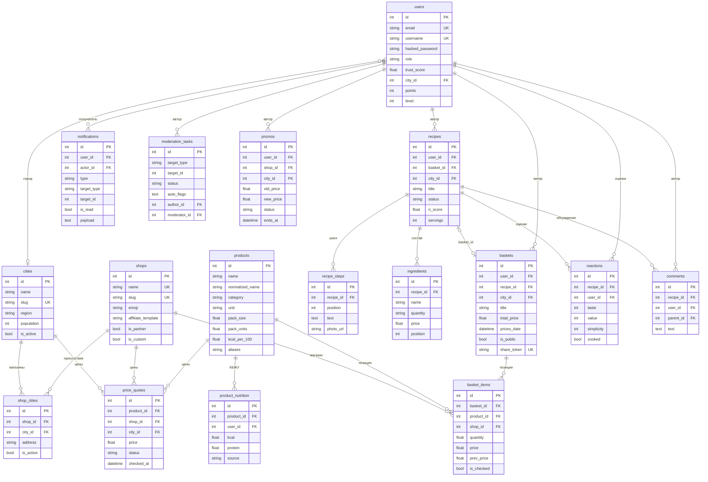

# Модель данных Recartly

Документ описывает таблицы PostgreSQL, их главные поля, связи, ограничения и то, где хранится
история. Источник правды — SQLAlchemy-модели в `backend/app/models/`; фактическая схема в
существующей БД дополняется скриптом `backend/scripts/migrate_smeta.py`.

## Оглавление

1. [Соглашения](#соглашения)
2. [ER-диаграмма](#er-диаграмма)
3. [Таблицы по доменам](#таблицы-по-доменам)
4. [Ограничения и индексы](#ограничения-и-индексы)
5. [Каскады и удаление](#каскады-и-удаление)
6. [Где хранится история](#где-хранится-история)
7. [Денормализация и пересчёт](#денормализация-и-пересчёт)
8. [Управление схемой](#управление-схемой)

## Соглашения

- Имена таблиц — во множественном числе (`users`, `baskets`, `price_quotes`), поля —
  `snake_case`.
- Первичные ключи — целые `id` c индексом.
- Даты — `DateTime(timezone=True)`; `created_at` обычно `server_default=func.now()`,
  `updated_at` — `onupdate=func.now()` (обновляется ORM, не триггером).
- Статусы и типы — строки с фиксированным набором значений (см. таблицу статусов в
  [`BACKEND.md`](BACKEND.md#статусы-которые-встречаются-в-моделях)), без enum-типов PostgreSQL.
- JSON хранится строкой в `Text` (`notifications.payload`, `moderation_tasks.auto_flags`,
  `audit_log.payload`) — сознательный отказ от JSONB ради переносимости.
- Денежные значения — `Float` (не `Numeric`): округление выполняется в коде
  (`round(..., 2)`), что важно учитывать при точных финансовых отчётах.

## ER-диаграмма

Упрощённая схема ключевых сущностей (17 таблиц; остальные перечислены ниже).

Связь «рецепт ↔ набор» двусторонняя: `recipes.basket_id` и `baskets.recipe_id` (оба nullable,
`ON DELETE SET NULL`) — по ней блюдо попадает в бюджетный раздел. У `moderation_tasks` две
ссылки на `users` (`author_id` и `moderator_id`); на диаграмме показана только авторская.

## Таблицы по доменам

### Пользователи и доверие

| Таблица | Главные поля | Связи и назначение |
|---|---|---|
| `users` | `email` (unique), `username` (unique), `hashed_password`, `avatar_url`, `bio`, `city`, `website`, `role`, `trust_score` (0–100), `city_id`, `is_banned`, `muted_until`, `points`, `level` | `city_id` → `cities` (SET NULL); автор рецептов, наборов, комментариев, реакций, отзывов, ачивок |
| `achievements` | `user_id`, `type` (код), `name`, `description`, `icon`, `earned_at` | `user_id` → `users`; выданные ачивки, код — ключ из `ACHIEVEMENTS` |

### География и магазины

| Таблица | Главные поля | Связи и назначение |
|---|---|---|
| `cities` | `name` (индексируется, но **не уникально** — есть одноимённые города), `slug` (unique), `region`, `population`, `is_active` | магазины города через `shop_cities`; цены через `price_quotes`; город пользователя |
| `shops` | `name` (unique), `slug` (unique), `emoji`, `brand_color`, `is_online`, `website`, `affiliate_template`, `is_partner`, `is_custom`, `created_by` | сети и личные магазины; цены, позиции наборов, акции |
| `shop_cities` | `shop_id`, `city_id`, `address`, `is_active` | уникальная пара `uq_shop_city`; присутствие сети в городе |
| `user_shops` | `user_id`, `shop_id` | уникальная пара `uq_user_shop`; привязка «магазина у дома» к автору (сам магазин лежит в `shops` с `is_custom = true`) |

### Каталог, цены, КБЖУ

| Таблица | Главные поля | Связи и назначение |
|---|---|---|
| `products` | `name`, `normalized_name`, `category`, `unit` (`кг`/`л`/`шт`/`г`/`мл`/`упак`), `pack_size`, `pack_units`, `kcal_per_100`, `protein_per_100`, `fat_per_100`, `carbs_per_100`, `season_months`, `aliases`, `is_verified` | цены, КБЖУ-записи, позиции наборов |
| `product_nutrition` | `product_id`, `user_id`, `kcal`, `protein`, `fat`, `carbs`, `source` (`user`/`moderator`/`import`) | `product_id` → `products` (CASCADE); несколько записей на продукт, при расчёте берётся медиана |
| `price_quotes` | `product_id`, `shop_id`, `city_id`, `price`, `unit_amount`, `source` (`user`/`parser`/`moderator`/`seed`), `status`, `photo_url`, `reported_by`, `checked_at`, `created_at` | снимок цены на дату; `reported_by` → `users` (SET NULL); индекс `ix_price_lookup` |

### Рецепты

| Таблица | Главные поля | Связи и назначение |
|---|---|---|
| `recipes` | `title`, `description`, `instructions`, `photo_url`, `user_id`, `servings`, `cook_time_min`, `difficulty` (1–3), `category`, `city_id`, `season_months`, `basket_id`, КБЖУ на порцию, `ri_score`, `reactions_count`, `cooked_count`, `status`, `reject_reason`, `moderated_by`, `moderated_at`, `is_verified` | автор → `users`; `basket_id` → `baskets` (SET NULL); `city_id` → `cities` (SET NULL); ингредиенты, шаги, комментарии, реакции, избранное |
| `recipe_steps` | `recipe_id`, `position`, `text`, `photo_url` | `recipe_id` → `recipes` (CASCADE); `instructions` остаётся текстовой выжимкой, шаги — отдельные записи |
| `ingredients` | `recipe_id`, `name`, `quantity` (текстом: «500 г»), `price` (легаси-поле для отображения), `photo_url`, `position` | `recipe_id` → `recipes`; сопоставление с `products` происходит в `pricing_service` по названию, а не внешним ключом |

### Наборы (центральная сущность)

| Таблица | Главные поля | Связи и назначение |
|---|---|---|
| `baskets` | `user_id`, `recipe_id`, `city_id`, `title`, `description`, `photo_url`, `receipt_photo_url`, `strategy` (`single`/`split`), `servings`, `budget`, `total_price`, `savings`, `prices_date`, `is_public`, `is_family`, `share_token` (unique), `status`, `reject_reason`, `likes_count`, `views_count` | автор, город, рецепт; позиции, лайки, комментарии; индексы `ix_baskets_public_status`, `ix_baskets_total` |
| `basket_items` | `basket_id`, `product_id`, `name`, `quantity`, `unit`, `shop_id`, `price` (стоимость позиции целиком), `prev_price`, `photo_url`, `is_checked`, `checked_by`, `position` | `basket_id` → `baskets` (CASCADE); `product_id`/`shop_id` → SET NULL; `checked_by` → `users` |
| `basket_likes` | `basket_id`, `user_id` | уникальной пары нет — повтор предотвращается кодом роутера |
| `basket_comments` | `basket_id`, `user_id`, `parent_id`, `text` | `parent_id` → `basket_comments` (CASCADE) — дерево ответов |
| `basket_comment_reactions` | `comment_id`, `user_id`, `emoji` | одна реакция на комментарий от пользователя (по одному эмодзи) |
| `purchase_clicks` | `user_id`, `shop_id`, `basket_id`, `recipe_id`, `url`, `referer`, `user_agent`, `created_at` | журнал партнёрских переходов; все ссылки SET NULL, чтобы история не блокировала удаление |

### Обсуждение и реакции на рецепт

| Таблица | Главные поля | Связи и назначение |
|---|---|---|
| `comments` | `text`, `user_id`, `recipe_id`, `parent_id`, `created_at` | `parent_id` → `comments` (SET NULL); `recipe_id` → `recipes` |
| `reactions` | `recipe_id`, `user_id`, `taste`, `value`, `simplicity` (1–5), `cooked` | уникальная пара `uq_reaction_user_recipe`; основа Индекса Recartly |
| `cooked_photos` | `recipe_id`, `user_id`, `photo_url`, `status` (`pending`/…), `created_at` | фото «что получилось»; модерация на стороне админки |
| `favorites` | `user_id`, `recipe_id` | уникальной пары нет — повтор проверяется роутером |
| `reviews`, `review_likes`, `review_comments` | `title`, `content`, `rating`, `target_type`, `target_id`, `shop_name`; лайки и комментарии | API живой, UI не использует; `target_type` — `recipe`/`cart`/`shop` |

### Модерация

| Таблица | Главные поля | Связи и назначение |
|---|---|---|
| `moderation_tasks` | `target_type` (`recipe`/`cart`/`review`/`comment`/`price`/`avatar`/`photo`/`promo`), `target_id`, `status`, `priority`, `reason_code`, `moderator_comment`, `moderator_id`, `auto_flags` (JSON-строка), `author_id`, `resolved_at` | `moderator_id`/`author_id` → `users` (SET NULL); единая очередь |
| `reports` | `target_type`, `target_id`, `reporter_id`, `reason_code`, `comment`, `status`, `moderator_id`, `resolution`, `resolved_at` | жалобы пользователей, разбираются в `/admin/reports` |
| `audit_log` | `actor_id`, `action`, `target_type`, `target_id`, `payload` (JSON), `created_at` | неизменяемый журнал действий модераторов и админов |
| `user_sanctions` | `user_id`, `kind`, `reason`, `issued_by`, `expires_at`, `is_active`, `appeal_text`, `appeal_status` | санкции с историей и апелляцией |

### Планы, остатки, челленджи, акции, уведомления

| Таблица | Главные поля | Связи и назначение |
|---|---|---|
| `meal_plans` | `user_id`, `city_id`, `title`, `budget`, `days`, `servings`, `diet` (`any`/`pp`/`vegetarian`/`high_protein`), `kcal_target`, `protein_target`, `total_price`, `is_active` | план питания; позиции каскадно |
| `meal_plan_items` | `plan_id`, `recipe_id`, `day_index`, `meal_type`, `servings`, `price`, `kcal`, `protein`, `fat`, `carbs`, `position` | `plan_id` → `meal_plans` (CASCADE); `recipe_id` → SET NULL |
| `pantry_items` | `user_id`, `product_id`, `name`, `quantity`, `unit`, `expires_at`, `created_at` | остатки дома; `product_id` → SET NULL |
| `challenges` | `title`, `slug` (unique), `description`, `emoji`, `budget`, `servings`, `city_id`, `starts_at`, `ends_at`, `is_active` | челленджи бюджета |
| `challenge_entries` | `challenge_id`, `user_id`, `recipe_id`, `basket_id`, `total_price`, `score` | уникальная пара `uq_challenge_user`; заявки каскадно от челленджа |
| `promos` | `user_id`, `shop_id`, `city_id`, `product_id`, `title`, `description`, `old_price`, `new_price`, `unit`, `photo_url`, `starts_at`, `ends_at`, `status`, `reject_reason`, `moderated_by`, `moderated_at`, `is_verified`, `likes_count`, `views_count` | акция со сроком; `promo_likes` — лайки |
| `notifications` | `user_id`, `type`, `title`, `body`, `actor_id`, `target_type`, `target_id`, `payload` (JSON), `is_read`, `created_at` | получатель и актор — `users`; индекс `ix_notifications_user_read_created` |

Итого 37 таблиц: `users`, `recipes`, `recipe_steps`, `ingredients`, `comments`, `favorites`,
`achievements`, `reviews`, `review_likes`, `review_comments`, `cities`, `shops`, `shop_cities`,
`user_shops`, `products`, `product_nutrition`, `price_quotes`, `reactions`, `cooked_photos`,
`baskets`, `basket_items`, `basket_likes`, `basket_comments`, `basket_comment_reactions`,
`purchase_clicks`, `moderation_tasks`, `reports`, `audit_log`, `user_sanctions`, `meal_plans`,
`meal_plan_items`, `pantry_items`, `challenges`, `challenge_entries`, `notifications`, `promos`,
`promo_likes`.

## Ограничения и индексы

### Уникальность

| Ограничение | Таблица | Комментарий |
|---|---|---|
| `email`, `username` | `users` | регистрация проверяет оба поля |
| `slug` | `cities`, `shops`, `challenges` | человекочитаемый идентификатор |
| `name` | `shops` | сеть не может называться одинаково дважды |
| `share_token` | `baskets` | ссылка на семейный набор |
| `uq_shop_city (shop_id, city_id)` | `shop_cities` | одна связка «магазин в городе» |
| `uq_user_shop (user_id, shop_id)` | `user_shops` | один личный магазин на пользователя |
| `uq_reaction_user_recipe (recipe_id, user_id)` | `reactions` | одна оценка рецепта на пользователя |
| `uq_challenge_user (challenge_id, user_id)` | `challenge_entries` | одна заявка на челлендж |

Особенности:

- `cities.name` **не уникально**: в России есть одноимённые города; уникальность обеспечивает
  `slug`, а `migrate_smeta.py` явно снимает старые ограничения `cities_name_key`.
- У `favorites`, `basket_likes`, `promo_likes`, `review_likes` нет составных уникальных
  ограничений — дубли предотвращаются проверкой в роутерах, поэтому при прямых вставках в БД
  дубли возможны.
- `comments.parent_id` и `basket_comments.parent_id` не защищены от циклов на уровне БД.

### Индексы

| Индекс | Таблица | Зачем |
|---|---|---|
| `ix_price_lookup (product_id, city_id, shop_id, checked_at)` | `price_quotes` | выбор последней цены для продукта в городе/магазине |
| `ix_notifications_user_read_created (user_id, is_read, created_at)` | `notifications` | «мои уведомления, сначала непрочитанные и свежие» |
| `ix_baskets_public_status (is_public, status)` | `baskets` | лента публичных наборов |
| `ix_baskets_total (total_price)` | `baskets` | фильтр и сортировка по бюджету |
| `ix_recipes_status`, `ix_recipes_ri_score`, `ix_recipes_category` | `recipes` | ленты, сортировка по RI, фильтр категории |
| `ix_users_role` | `users` | выборки модераторов |
| `ix_cities_slug`, `ix_cities_name`, `ix_cities_population` | `cities` | поиск и сортировка городов |
| `ix_shops_slug` | `shops` | поиск по slug |
| `ix_products_name` | `products` | автодополнение и поиск |
| `ix_comments_parent_id` | `comments` | ответы на комментарии |
| `ix_notifications_user_read` | `notifications` | дополнительный индекс под счётчик |
| `ix_baskets_share_token`, `ix_baskets_status`, `ix_baskets_prices_date` | `baskets` | ссылка, статус, сортировка «свежие цены» |
| `ix_*_basket_id`, `ix_*_user_id`, `ix_*_recipe_id` | дочерние таблицы | типовые выборки по родителю |

Индексы из списка `INDEXES` в `migrate_smeta.py` создаются с `IF NOT EXISTS`; индексы,
объявленные через `index=True` в моделях, создаёт `Base.metadata.create_all` на новых БД.

## Каскады и удаление

| Родитель | Дочерняя таблица | Поведение |
|---|---|---|
| `baskets` | `basket_items`, `basket_likes`, `basket_comments` | `ON DELETE CASCADE` |
| `basket_comments` | `basket_comment_reactions`, ответы (`parent_id`) | `ON DELETE CASCADE` |
| `recipes` | `recipe_steps` | `ON DELETE CASCADE` |
| `products` | `product_nutrition`, `price_quotes` | `ON DELETE CASCADE` |
| `shops`, `cities` | `shop_cities`, `price_quotes` | `ON DELETE CASCADE` |
| `meal_plans` | `meal_plan_items` | `ON DELETE CASCADE` |
| `challenges` | `challenge_entries` | `ON DELETE CASCADE` |
| `promos` | `promo_likes` | `ON DELETE CASCADE` |
| `users` | `notifications`, `user_shops`, `basket_likes`, `basket_comments`, `reactions`, `challenge_entries`, `user_sanctions`, `promos` | `ON DELETE CASCADE` (там, где указано в модели) |
| `users`, `cities`, `shops`, `products`, `recipes` | ссылки из `moderation_tasks`, `reports`, `audit_log`, `price_quotes.reported_by`, `promos`, `baskets`, `recipes` | `ON DELETE SET NULL` — история модерации и цены остаются |

Практические следствия:

- удаление набора не удаляет рецепт: `baskets.py` сначала делает
  `UPDATE recipes SET basket_id = NULL`, затем удаляет набор;
- удаление рецепта каскадно убирает шаги; ингредиенты, комментарии, избранное и реакции
  удаляются на уровне ORM-связей (`cascade="all, delete-orphan"`) при удалении через ORM;
- удаление пользователя может быть заблокировано внешними ключами без `ON DELETE` (например,
  `recipes.user_id` объявлен без каскада) — поэтому `cleanup_test_data.py` удаляет зависимости
  вручную и в правильном порядке.

## Где хранится история

| Что | Где | Глубина |
|---|---|---|
| Предыдущая цена позиции набора | `basket_items.prev_price` | одна предыдущая цена; при обновлении `price` перезаписывается, `prev_price` получает старое значение |
| Дата актуальности цен набора | `baskets.prices_date` | одна дата; по ней считается свежесть (`fresh` ≤ 7 дней, `recent` ≤ 30, иначе `stale`) |
| История цен справочника | `price_quotes` | полноценные снимки: каждая запись — цена на `checked_at`; сид создаёт точки за 30, 21, 14 и 7 дней |
| Партнёрские переходы | `purchase_clicks` | все клики с URL, referer и user-agent |
| Решения модерации | `audit_log` | неизменяемые записи с JSON-payload |
| Автофлаги задач | `moderation_tasks.auto_flags` | JSON-строка на момент постановки в очередь |
| Уведомления | `notifications.payload` | JSON-строка с деталями события |
| Санкции | `user_sanctions` | все выдачи, включая истёкшие (`is_active`) |

Чего **нет**:

- полной истории изменения позиции набора (только `prev_price`, а не цепочка версий);
- версий рецепта (правки перезаписывают строку; `updated_at` фиксирует только факт изменения);
- soft-delete: удалённые записи исчезают физически;
- журнала изменения цен набора (история есть только у `price_quotes`).

## Денормализация и пересчёт

| Поле | Где | Когда обновляется |
|---|---|---|
| `baskets.likes_count` | `baskets` | `POST/DELETE /baskets/{id}/like` |
| `baskets.views_count` | `baskets` | `GET /baskets/{id}` (каждый просмотр) |
| `promos.likes_count`, `promos.views_count` | `promos` | лайки и `GET /promos/{id}` |
| `recipes.ri_score`, `recipes.reactions_count`, `recipes.cooked_count` | `recipes` | `recalculate_recipe_ri()` после реакций и удаления реакции |
| `baskets.total_price`, `baskets.savings` | `baskets` | создание, обновление цен, оптимизация, `seed_baskets` |
| `users.points`, `users.level` | `users` | `check_achievements()` |
| `users.trust_score` | `users` | одобрение/отклонение модерации, ачивки |
| `meal_plans.total_price` | `meal_plans` | генерация плана |

Денормализация сделана ради дешёвых лент: сортировка по лайкам и RI не требует `COUNT`/`AVG` по
дочерним таблицам. Плата — возможное расхождение при прямых правках БД; при необходимости
пересчитывайте значения сервисами, а не SQL-апдейтом «на глаз».

## Управление схемой

- **Основной механизм** — `backend/scripts/migrate_smeta.py`: `Base.metadata.create_all(engine)`
  для отсутствующих таблиц + `ALTER TABLE ... ADD COLUMN IF NOT EXISTS` для существующих
  (списки `RECIPE_COLUMNS`, `USER_COLUMNS`, `PRODUCT_COLUMNS`, `MEALPLAN_COLUMNS`,
  `COMMENT_COLUMNS`, `BASKET_COLUMNS`, `BASKET_ITEM_COLUMNS`, `SHOP_COLUMNS`,
  `INGREDIENT_COLUMNS`), затем индексы и внешние ключи с проверкой `pg_constraint`.
- **Alembic** присутствует (`backend/alembic`, `alembic.ini`), но используется формально: в
  `versions` одна ревизия `001_add_photo_url.py`. Автогенерации и цепочки ревизий нет.
- **Правило для новой колонки:** добавить поле в модель **и** в соответствующий список колонок
  `migrate_smeta.py`; иначе на уже существующей базе колонка не появится, и приложение упадёт на
  запросе.
- **Проверка схемы:** `check_schema.py` (наличие таблиц и колонок), `check_db.py` (таблицы,
  версия Alembic, количество строк), `summary.py` (счётчики по ключевым таблицам).
